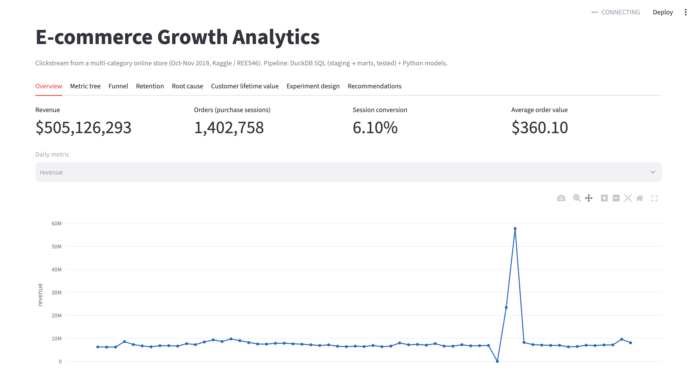

# E-commerce Growth Analytics

> **Analyzed 110M clickstream events from a multi-category online store. Found that purchases collapsed to near zero (1 order from 762K sessions) on the first day of the store's biggest sale, built a customer lifetime value model with 3% holdout error (vs 52% for a naive baseline), and designed a powered A/B test for cart-abandonment emails.**

End-to-end product analytics on **110M events** (views, add-to-carts, purchases) from **5.3M users**,
October-November 2019. Built with DuckDB SQL and Python, entirely on a laptop.



---

## Questions this project answers
1. **What is the North Star metric, and what drives it?** A metric tree breaks Weekly Purchasing Users into traffic, cart rate and cart-to-purchase rate.
2. **Conversion dropped. Why?** A mix/rate decomposition separates "different users showed up" from "something broke in a segment," followed by a daily drill-down.
3. **Which customers are worth the most?** BG/NBD + Gamma-Gamma models predict each customer's future purchases and spend, validated on a holdout period.
4. **Would cart-reminder emails work, and how should we test it?** A powered A/B test design built from the measured baseline.

## Key results

| Area | Result |
|---|---|
| Data | 109.95M raw events -> 109.56M after cleaning (99.65% kept): removed 256,761 zero-price records, 130,635 exact duplicates and 12 rows without a session |
| Sessions | 23.0M sessions; 939 (0.004%) carry more than one user ID, flagged by a warning-level test and left in (effect below 0.01% on any metric) |
| Root cause | Automated RCA flagged an 18.6% week-over-week conversion drop (6.16% -> 5.01%, week of Nov 18). The daily drill-down showed the *comparison* week was the anomaly: a sale with traffic up to ≈2.5x normal, **1 purchase recorded from 762K sessions on Nov 15**, then a record $57.8M on Nov 17 (15.6% conversion) |
| CLV | 432,736 customers. Holdout purchases: **150,247 predicted vs 154,814 actual (-3.0%)**; naive baseline +51.9%. Per-customer MAE 21% lower than baseline. **Top 10% of customers hold 49.5% of predicted 90-day value** |
| Experiment | 23.3% of ≈111K weekly cart abandoners buy within 7 days with no nudge. **83,289 users per arm for 2 weeks** detects a 2.5% relative lift (power 79.4% and A/A false-positive rate 4.5% confirmed by simulation) |

## Recommendations
1. **Alert on purchase activity in real time and investigate Nov 15.** Traffic hit 762K sessions but only 1 purchase was recorded (a normal day has ≈20K, ≈$7M revenue). Whether checkout or tracking failed, it went unnoticed during the biggest sale. An hourly alert on purchases vs expected level would catch this within an hour.
2. **Protect the top 10% of customers.** They hold ≈50% of predicted value. A VIP retention program, prioritising high-value customers whose probability of still being active is falling, protects ≈5% of total predicted CLV for every 10% of that value retained.
3. **Test reminder emails before rolling them out.** Even the minimum detectable 2.5% lift is worth an estimated ≈650 extra purchasing users per week (≈$220K/week at a ≈$340 average order).

See the [one-page memo](reports/memo.md) for the full write-up.

---

## How it works

```
Kaggle CSVs (14 GB)
   │  src/load_data.py      -> compressed Parquet (1.8 GB)
   ▼
raw_events (view over Parquet)
   │  sql/staging/          -> filter invalid rows, dedupe in 3-day chunks, parse timestamps, derive segments
   ▼
stg_events  ──► sql/tests/  (10 data quality tests: uniqueness, valid prices, revenue reconciliation, ...)
   │  sql/marts/
   ▼
fct_sessions ─► daily KPIs · weekly metric tree · funnel by segment · cohort retention
             └► cart abandonment · user purchase log
   │  Python
   ▼
src/rca.py (root cause)  ·  src/clv.py (BG/NBD + Gamma-Gamma)  ·  src/experiment.py (power analysis)
   ▼
dashboard/app.py (Streamlit)
```

The full build (110M rows) runs in about 80 seconds on an M1 MacBook Air.

**Design choices**
- **DuckDB + Parquet**: no server, no cost; the 14 GB of CSVs compress to 1.8 GB.
- **Chunked processing**: the first version deduplicated all 110M rows at once and filled 30+ GB of temporary disk. Processing in 3-day windows (dedupe) and user groups (sessionization) brought temporary disk use to ≈0 with identical results.
- **Staging -> marts layers** (dbt-style): cleaning happens once; every analysis reads from tested tables.
- **SQL tests**: each test is a query returning rule-breaking rows; the pipeline stops if any `error` test fails.
- **CLV models implemented from the original papers** (Fader, Hardie & Lee 2005) with scipy, and checked by simulation in `tests/` (they recover known parameters; 1.1% holdout error on simulated data).

## Run it yourself
```bash
python3.11 -m venv .venv && source .venv/bin/activate
pip install -r requirements.txt

# Optional: 1-minute test run on synthetic data
ECOM_ENV=sample python -m src.make_sample_data
ECOM_ENV=sample python -m src.pipeline

# Real data: put 2019-Oct.csv and 2019-Nov.csv from Kaggle into data/raw/, then
python -m src.pipeline
streamlit run dashboard/app.py
```

## Repository layout
```
src/          pipeline steps and analyses (load, build, data_tests, rca, clv, experiment, export)
sql/staging/  cleaning layer
sql/marts/    analysis-ready tables
sql/tests/    data quality tests
tests/        model validation by simulation
dashboard/    Streamlit app + small exported data
outputs/      analysis results (markdown/CSV/JSON)
reports/      memo
```

## Limitations
- Two months of data: retention and CLV horizons are short, and early weeks overstate "new" users (left-censoring).
- The data can't show whether Nov 15 was a checkout failure or a tracking gap. Both need fixing, but the revenue impact differs.
- The CLV holdout period (Nov 10-30) includes the sale spike, which makes it a hard test. Frequency and spend correlate at 0.145, a mild violation of the Gamma-Gamma independence assumption.
- Some purchases have no add-to-cart event, so cart-to-purchase is "purchasers per cart user," not a strict funnel step.
- Revenue = item price (no discounts, returns or margin data). Impact estimates assume recovered orders are average-sized.
- The experiment is a **design**, not a result. It would need to be run to measure a real effect.

**Data:** [eCommerce behavior data from multi category store](https://www.kaggle.com/datasets/mkechinov/ecommerce-behavior-data-from-multi-category-store) (REES46 Open CDP), Kaggle.
